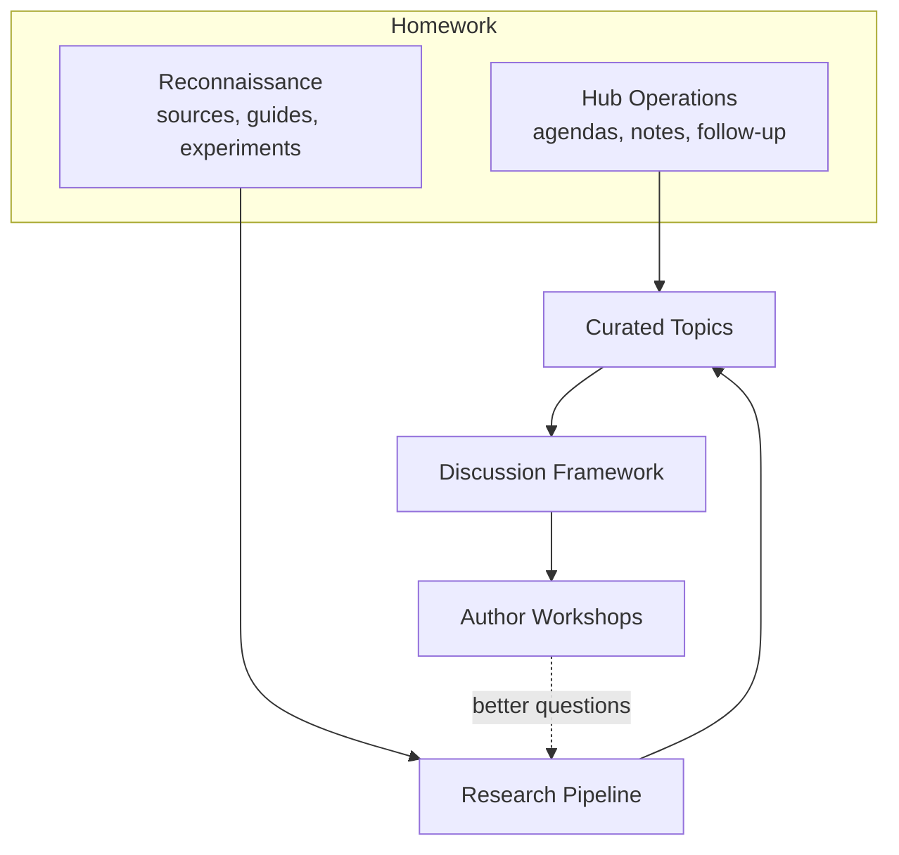

<!--
GENERATED FILE. DO NOT EDIT DIRECTLY.

The authoritative source is in content/. Regenerate this reading copy with:
    python process/tools/build_core_markdown.py --assembly ConformanceReboot2027.qmd
-->

# Conformance Reboot 2027

*A tentative proposal for Conformance Work Group feedback*

> This is a generated reading copy for GitHub. For review and editing, use the
> [canonical section files](content/README.md).

---

# Status and Scope

> **Status:** Tentative proposal for feedback. Everything in this document,
> including the working decisions, is a draft proposal from the Conformance
> cochairs. It is waiting for feedback from Work Group participants and others.
> Publishing the draft starts that review; it does not approve the content.
> Nothing here is a published standard, an HL7 ballot, or a final decision.

## In brief

The HL7 Conformance Work Group needs to reboot and restart its engagement with
the community. In recent years, participation has been small and the group has
had few active projects. Meanwhile, conformance questions have spread into a
growing number of FHIR implementation guides, testing programs, and exchange
networks. The group has agreed to try a new way of working in 2027.

The proposed approach is **research first**. Before reaching out to guide
authors, Conformance would spend about six months on homework:

- learning what is happening across FHIR implementation guides, with research
  support from the Prometheus team and expert review from Rob Snelick and
  Frank Oemig
- running the group's agendas, notes, and follow-up in InteropHub

What the group learns would shape a discussion framework and, when the group is
ready, voluntary workshops with guide authors. At the end of 2027 the group
would look back on what worked and plan its next steps.

## Purpose

This Topic Reference gathers into one place what has been proposed and decided
about the reboot so far, so the Work Group can review it, correct it, and
improve it. It is meant to become the running record of the reboot through
2027:

- what the group is trying to do
- how the work is organized and who does what
- what has been decided
- what is still open

## Where things stand

As of November 2026:

- **Agreed direction.** At the September 2026 HL7 Working Group Meeting, the
  group agreed to proceed with a reboot and to do its homework before outreach.
- **Hub Operations has begun.** Conformance has a Topic Space in InteropHub
  and runs its meeting agendas and notes there.
- **Reconnaissance has begun.** The Prometheus team received a starter
  packet, which was discussed with the group on October 6, 2026. The team is
  currently focusing on validating the International Patient Summary (IPS) and
  Occupational Data for Health (ODH). Experience from an IHE testing event,
  described in [Related Work](#related-work), is already raising useful
  questions.
- **This document** is the first gathering of the proposals into a single
  draft for review.

## What this project covers

- why the reboot is needed and what it is meant to change
- the proposed mission, principles, and limits of the work
- the research-first approach and the named parts of the work
- the people involved and their roles
- how progress will be judged, and the review at the end of 2027
- the working decisions and open questions about the reboot itself

## What this project does not cover

- **Substantive conformance findings**, such as IPS bundle conformance,
  validator error behavior, or acknowledgment patterns. As the research
  produces them, they become separate curated topics in the Conformance Topic
  Space.
- **The technical design of research tooling**, including the Prometheus
  research environment and any future FHIR conformance tooling. See
  [Related Work](#related-work).
- **Project intake for InteropHub generally.** This is a broader, future
  effort.
- **The Core Intent and acknowledgment behavior work**, which is a separate
  effort. Where it belongs is an open question.

## How to comment

Comment beside any paragraph in the web guide, or raise points in a Conformance
Work Group meeting. Meetings and notes are tracked in
[InteropHub topic 146](https://informatics.immregistries.org/hub/es/topic/146).
Every comment is considered, and the change made, or the reason for not making
one, is recorded in the next release.

---

# Related Work

The reboot draws on, and stays separate from, several related efforts. This
section names each one and how it relates to the reboot.

## Related topics

| Topic | Relationship to this work |
|---|---|
| [Conformance Reboot 2027, topic 146](https://informatics.immregistries.org/hub/es/topic/146) | This work. Meetings, agendas, and notes. |

As Reconnaissance produces findings, curated Conformance topics will be added
here.

## FHIR conformance tooling

The Prometheus team expects to investigate tooling that supports FHIR
conformance. The reboot's research helps that work, for example by showing:

- which conformance constructs guides use, and how consistently
- where guides give computable or testable expectations
- where tool support could reduce ambiguity or effort

This interest is **adjacent to the reboot, not part of it**. Taking part in the
research does not mean Conformance endorses a product or a tooling direction.
Author Workshops are not product-validation sessions. Concrete tooling
proposals would go through the appropriate HL7 and community processes.

## IHE testing events and the International Patient Summary

Work at a recent IHE testing event on the International Patient Summary used
Matchbox, an open-source validator built on the HAPI FHIR validator. That
experience raised questions that fit the reboot's interests:

- **Bundle definitions:** how to define what a document bundle must contain
  when its parts can claim different profiles
- **Validator results:** how to read validator output, including whether some
  warnings should be errors
- **Outcome tables:** whether a "truth table" is needed that states what each
  detected issue means for the outcome

These questions are recorded in the topic 146 meeting notes. They are
candidates for curated topics, not conclusions. A European testing event in
April 2027 may also be relevant.

## The HL7 FHIR Community Process

The [FHIR Community Process](https://hl7.org/permalink?FCPRequirements) sets
requirements for organizations, projects, and specifications that publish FHIR
content outside HL7. The requirements cover publication rules, registration,
documentation of quality, and how issues are raised. It is relevant context for
how guides are published and discovered, and for the kinds of conformance
expectations that guides document.

## The Healthcare Interoperability Standards Compliance Handbook

Rob Snelick and Frank Oemig wrote the *Healthcare Interoperability Standards
Compliance Handbook*. It records how they reason about conformance in general,
and could supply concepts, distinctions, and research questions for
Reconnaissance. It does not define FHIR conformance requirements; where its
concepts differ from FHIR, the difference should be stated explicitly. One
idea is to convert a bounded section into a form research agents can use.
This depends on permission and review by the authors.

## Core Intent and acknowledgment behavior

A separate Conformance discussion considers how to define the minimum business
outcome of a transaction, which it calls "Core Intent", and how
acknowledgments should report it, across HL7 v2 and FHIR. It builds on an
acknowledgment management framework that describes how acknowledgment
behavior varies across implementations. It is related work, not part of the
reboot.

## Project intake for InteropHub

A broader idea would use AI-assisted intake to watch public FHIR activity and
propose topics for InteropHub generally. It is future work, to be revisited
once the reboot shows what is worth tracking.

---

# Why a Reboot, and the Proposed Mission

## Where the group is

Conformance has deep experience with HL7 v2 implementation, testing, and
validation, and with the practical cost of ambiguous requirements. But in
recent years the group has not had a working model for putting that experience
to use:

- **Participation has been small.** Too often, meetings have had only the cochairs.
- **There are few active projects.** Earlier efforts to carry established
  conformance practice into FHIR did not gain enough support to continue.
- **Review ends at the review.** Reviewing Project Scope Statements usually
  ends with a vote of support and no further contact with the project.
- **The work is spread out.** Implementation activity is spread across many
  work groups, guides, agencies, and tooling efforts. No small volunteer group
  can follow it by hand.
- **The group doesn't yet know enough.** It does not yet understand current
  practice across FHIR implementation guides well enough to advise their
  authors.

These conditions reinforce each other. Without active work there is little
reason to attend, and without participants the group cannot start new work.
Asking more people to attend is not enough. The group first needs work that
gives people a concrete reason to take part.

## Why conformance still matters

Conformance problems have not gone away. They now show up in more places:

- HL7 v2 remains heavily used in operational and regulated exchange.
- FHIR implementation guides continue to multiply.
- Certification and testing programs need requirements they can measure.
- Reporting and other directed exchanges need clear obligations,
  acknowledgments, and evidence that the intended action happened.
- Implementers still bear the cost of inconsistent interpretation and local
  variation.

Conformance does not need to own these problems. Its lasting advantage is a
perspective that spans specifications, implementation guides, testing tools,
and real-world exchange. That perspective is useful even when Conformance does
not sponsor a project or write its solution.

## What changes

The group has agreed to try a new way of working in 2027. Instead of
starting with standards development or with outreach, it starts by learning:

- researching current practice, with help that makes the research feasible
  for a small group
- organizing its own work so that what it learns is kept and can be found
- then using that knowledge to offer guide authors useful, voluntary
  conversations

The rest of this chapter proposes the mission and principles for that work, and
[The Work](#the-work) describes how it is organized.

## Proposed mission

> **Connect projects, people, and practical experience so that conformance
> considerations are discovered earlier, discussed openly, and carried into
> implementation.**

The longer-term aim is to:

> **Help implementation guide authors examine and improve how they define,
> communicate, and support conformance, through collaborative,
> evidence-informed workshops.**

Under this mission, Conformance would discover relevant work, keep lightweight
records so that what is learned is not lost, ask practical questions about
requirements, validation, testing, and acknowledgment, and spot recurring
problems that may eventually justify guidance, tooling, or standards work.

## Principles

- **Learn before prescribing.** The first task is to understand current work,
  not to reintroduce a predetermined method.
- **Evidence before conclusions.** Findings stay connected to their sources,
  versions, and limitations. "No evidence was found in what we reviewed" is
  not the same as "the practice does not exist."
- **People interpret.** AI helps with discovery and analysis; conformance
  experts and guide authors judge what matters and make decisions.
- **Keep kinds of knowledge separate.** Published requirements, reviewed
  expert interpretations, community observations, and unresolved questions
  stay visibly distinct. An automated summary never silently promotes one
  into another.
- **Curated transparency.** InteropHub shows a useful, understandable view,
  not every raw or speculative observation.
- **Service, not judgment.** Engagement helps authors reason about their work;
  it does not certify or score it.
- **Gradual commitment.** Each part of the work is justified by what the
  earlier parts learned.
- **Expect experimentation.** False starts are useful findings, not failures.
- **Respect project ownership.** Guide authors and their sponsoring work groups
  keep authority over their projects.

## What the reboot will not do

During 2027, Conformance does not plan to:

- create a new conformance methodology, or revise foundational FHIR
  conformance constructs
- publish specifications or formal guidance before a need and willing
  contributors are visible
- tell other projects how they must handle conformance, or review or approve
  their technical designs
- certify, score, or act as a gate for any guide
- require permanent liaisons or co-sponsorship as a condition of engagement
- take ownership of problems that belong to another work group
- contact guide authors before the homework supports it

---

# The Work

The work is organized as **named parts**, not numbered phases. The plan is
expected to change, and parts may overlap, run in parallel, split, or be
reordered. Parts are added, renamed, or retired as the plan changes.

## Named parts of the work

| Part | Group | What it is | Status |
|---|---|---|---|
| **Reconnaissance** | Homework | The Prometheus team explores FHIR guide sources, runs small experiments, and learns which questions can usefully be asked | Under way |
| **Hub Operations** | Homework | Conformance runs agendas, notes, and follow-up in its InteropHub Topic Space | Under way |
| **Research Pipeline** | Homework | A repeatable way to discover guides, collect evidence, and prepare findings, designed from what Reconnaissance learns | Not started |
| **Curated Topics** | Homework | Selected findings become Conformance topics in InteropHub | Not started |
| **Discussion Framework** | Homework | A framework for reviewing a guide's conformance design with its authors; not a scoring or certification tool | Not started |
| **Author Workshops** | Engagement | Voluntary, collaborative sessions with guide authors | After the homework |
| **Year-End Review** | Checkpoint | A look back at 2027 to plan the group's next steps | End of 2027 |

The homework is expected to take about six months. That is an estimate, not a
fixed date; outreach begins when the homework supports it.

## Reconnaissance

Reconnaissance asks one question:

> **What can we discover, what information is available, and what questions
> can we usefully ask?**

It produces learning, not production infrastructure. Its outputs include:

- a map of guide sources
- a small experimental collection of guides
- examples of useful, ambiguous, and failed results
- a recommendation for what to try next

It deliberately does not try to inventory every guide, build a platform, score
guides, decide what good practice is, publish directly to InteropHub, or
prepare outreach.

**Two connected lines of research:**

- **Guide discovery and monitoring.** What guides and versions exist, what they
  publish, what changed, and what requirements can be located.
- **Conformance knowledge.** What a conformance concept means, how its meaning
  differs between FHIR releases, and what is authoritative, interpreted,
  disputed, or unresolved.

**Sources.** No single source answers every question. The sources include:

- the published FHIR specification by release, the FHIR IG Registry, guide
  package histories, and exact-version packages
- published guide pages and continuous builds
- source repositories
- HL7 Jira, Confluence, and ballot records
- validators and test assets
- government, national, and IHE sources
- publication announcements and community chat channels

Community discussion is evidence of questions and practice. It is not
authority on its own.

**A small start.** The proposed starting sample is five guides chosen for
variety rather than coverage: US Core, International Patient Summary, Bulk
Data Access, AU Core, and IHE MHD. It is paired with five concepts:

- Must Support and obligations
- slicing
- differential versus snapshot
- CapabilityStatement claims
- validation versus behavioral conformance

**Five starting questions to ask of a guide:**

1. Which actors are defined, and are they backed by CapabilityStatements?
2. Which constraints are local, and which are inherited?
3. What validation and testing expectations are stated, and what executable
   artifacts exist?
4. How are errors, acknowledgments, and processing outcomes specified?
5. Where is local variation permitted, and is that permission stated in
   narrative or in computable form?

These are starting questions, not a scorecard. Rob and Frank refine them as
examples come in. A key review question is whether an agent found meaningful
evidence or only matched familiar words.

**An early demonstration** should be inspectable. It should show what was
found, why, and what could not be established, including at least one
failure, ambiguity, or correction. Success means traceable evidence and better
questions, not a large number of documents collected.

## Hub Operations

Conformance uses its InteropHub Topic Space to:

- represent current work as topics
- build meeting agendas from those topics
- keep notes, decisions, and follow-up with each topic

This runs alongside everything else and does not wait for the research.
Later, InteropHub may also support invitations, pre-meeting questionnaires,
scheduling, and workshop notes.

InteropHub holds **curated topics only**. The detailed research, including
packages, extracted content, and AI observations, stays in the Prometheus
research environment.

## Research Pipeline and Curated Topics

**Research Pipeline.** If Reconnaissance shows the value, the Research
Pipeline would become a repeatable capability that:

- discovers new and changed guides
- keeps source and version information
- investigates specific questions
- preserves evidence
- separates machine-generated observations from expert conclusions

The pipeline can be summarized as:

> broad discovery → AI-assisted research → expert review → curated topic →
> Conformance discussion

Its design comes from Reconnaissance experience rather than being fixed in
advance.

**Curated Topics.** A curated topic gives the group what it needs to
understand why something matters and decide what to do next:

- the guide or project, with its version and sponsor
- links
- the reason for Conformance interest
- questions worth investigating
- a summary of selected evidence
- follow-up status

## Discussion Framework

Once enough guides have been reviewed, Conformance would draft a
**Conformance Design Review and Discussion Framework** to use with guide
authors. It helps authors and experts think systematically about how a guide
expresses and supports conformance. It does not decide whether a guide passes
or fails.

Candidate areas, to be confirmed by what the research shows:

- actors and their responsibilities
- required and optional behavior, and how obligations are expressed
- testability, validation, and testing
- errors and acknowledgments
- exceptions and local variation
- capability declarations
- examples and test data
- versioning and compatibility
- supporting tools and implementation experience

An earlier proposal included a set of reusable questions that can feed the
framework:

- **Implementation obligations.** Who must implement, are both sender and
  receiver obligations defined, and what must an implementer do to claim
  conformance?
- **Requirements and variation.** Which requirements are meant to be
  testable, where variation is allowed, and whether an implementation can
  materially change a requirement and still claim conformance.
- **Validation and testing.** What testing is expected, what reference
  implementations, examples, or validators will exist, and who maintains them.
- **Exchange outcomes.** How receipt, acceptance, rejection, and business
  processing are distinguished, how errors are reported, whether partial
  success is possible, and what retry or correction is expected.

## Author Workshops

When the research and framework are useful enough, Conformance would invite
selected guide authors to voluntary workshops. The proposed sequence:

1. The authors receive an invitation that explains the collaborative purpose.
2. They complete a short questionnaire and choose a time.
3. Conformance and the Prometheus team prepare evidence-based questions.
4. The authors present their guide, intentions, and concerns.
5. The group discusses the guide using the framework.
6. The authors may correct the notes.
7. Conformance records follow-up and improves its questions.

A workshop is a structured conversation and a chance for expert reflection.
It is **not** certification, approval, a score, a publication gate, a
compliance audit, an automated AI judgment, or a requirement to accept
recommendations. Authors are treated as experts in their own use cases.

Each workshop should improve the authors' understanding of their own
conformance approach, Conformance's understanding of current practice, the
framework, and the research questions.

## Parked and future work

- **PSS Engagement** (parked). The first proposal turned each Project Scope
  Statement review into an invitation to brief the group. The research-first
  approach replaced it, although its question set is reused above.
- **Project Intake** (future). A broader AI-assisted intake for InteropHub.
  See [Related Work](#related-work).

## People and roles

| Participant | Role |
|---|---|
| **Nathan Bunker** (Conformance cochair) | Coordinates the reboot; leads Hub Operations; prepared the Reconnaissance starter packet |
| **Rob Snelick and Frank Oemig** | Joint expert review: interpret findings, refine questions, and shape the Discussion Framework |
| **Prometheus team** (Youssef Bouij, Abdelghani El Ouakili) | Carry out Reconnaissance; run experiments, preserve evidence, report findings and limitations; build the Research Pipeline if justified |
| **Conformance Work Group** | Guides the reboot, discusses findings, tests whether the questions are useful, and will host Author Workshops |
| **Guide authors** | No current assignment. Later, voluntary workshop participants who explain their goals, correct misunderstandings, and consider improvements |

---

# Progress and the Year-End Review

## Measures of progress

Detailed metrics would be premature. The group proposes to judge progress by
the value and participation the work creates, not by the number of records or
meetings. Progress can be considered in four areas:

| Area | Signs of progress |
|---|---|
| **Research capability** | Relevant guide sources can be found and inspected. Questions produce evidence that experts can interpret. Guide versions and changes are understood well enough for the analysis. |
| **Operational capability** | Conformance runs its agendas, topics, notes, and follow-up in InteropHub. Curated findings can be represented without moving the whole research collection. |
| **Community value** | Guide authors find workshops useful and return for follow-up. Participation grows beyond the cochairs. Relationships form with other work groups and implementer communities. Recurring conformance challenges become visible, and people are willing to help investigate them. |
| **Sustainability** | The workload is manageable within the time actually available, and responsibilities can be shared. |

## Readiness for Author Workshops

Author Workshops begin when the homework supports them, not on a fixed date.
The signals that will show readiness have not been defined yet. They are an
open question for the group.

## Year-End Review

At the end of 2027, the group would look back at the year and ask:

- What did we learn about current conformance practice?
- Which parts of the work produced value, and which did not?
- Did participation and relationships grow?
- Is the workload sustainable, and can it be shared more widely?
- What should the group continue, change, or start in 2028?

The review is about how to carry the work forward. It is not a decision about
whether the group continues.

## Possible future directions

If the research supports them, later work could include:

- summaries of current conformance practice and challenges
- short issue briefs or implementation notes
- reusable questions or checklists for project teams
- recommendations to other HL7 work groups
- joint projects around clearly demonstrated needs
- narrowly scoped informative publications

These are possibilities, not commitments. They should come from what the group
learns and from the people willing to take part.

---

# Appendix: Working Decisions and Open Questions

This appendix gathers the working decisions on the reboot and the questions
still open. A working decision is the current position, proposed for
discussion. It is not final or approved. Each one records where it came from so
it can be revisited.

## Working decisions

| ID | Working decision | Basis |
|---|---|---|
| WD-1 | Conformance will reboot and restart its engagement in 2027. | Agreed at the September 2026 HL7 Working Group Meeting |
| WD-2 | Homework comes first. The group does about six months of research and preparation before reaching out to guide authors, and outreach begins when the homework supports it rather than on a fixed date. | September 2026 Working Group Meeting; cochair review, 2026-09-30 |
| WD-3 | The PSS-based engagement pilot is parked. Its standard question set is reused in the Discussion Framework. | September 2026 Working Group Meeting |
| WD-4 | Parts of the work are named, not numbered, so the plan can change without renumbering. | Cochair review, 2026-09-30 |
| WD-5 | Expert review of findings is done jointly by Rob Snelick and Frank Oemig. | Cochair review, 2026-09-30 |
| WD-6 | InteropHub holds curated topics only. Detailed research stays in the Prometheus research environment. | Evidence-to-Engagement concept, 2026-09-22 |
| WD-7 | Prometheus's interest in FHIR conformance tooling is adjacent to the reboot and is not a Conformance commitment or endorsement. | Evidence-to-Engagement concept, 2026-09-22 |
| WD-8 | AI-assisted project intake for InteropHub generally is future work, outside this topic. | Cochair review, 2026-09-30 |
| WD-9 | The end-of-2027 checkpoint is a Year-End Review that plans the group's next steps, not a decision about whether the group continues. | Cochair direction, 2026-11-10 |

## Open questions

Each question needs discussion before the affected text is settled. Questions
that belong to a related topic are referred there rather than answered here.

| ID | Question | Sources in tension | Status |
|---|---|---|---|
| OQ-1 | How will Rob and Frank review findings together: during Conformance calls, in separate sessions, or asynchronously? | Reconnaissance discussion, 2026-10-06 | Open |
| OQ-2 | Are the five starting guide questions, the five-guide sample, and the five-concept sample the right place to start? | Reconnaissance discussion, 2026-10-06 | Open |
| OQ-3 | Should converting a section of the Compliance Handbook be an explicit Reconnaissance task? Which section, who owns it, and what permissions are needed? | Cochair review, 2026-09-30; Reconnaissance discussion, 2026-10-06 | Open |
| OQ-4 | What evidence will show that Reconnaissance is mature enough to design the Research Pipeline? | Reconnaissance discussion, 2026-10-06 | Open |
| OQ-5 | What signals will show that the homework is sufficient to begin Author Workshops? | Cochair review, 2026-09-30 | Open |
| OQ-6 | Where does the Core Intent and acknowledgment behavior work belong: in Conformance, in v2 management, or elsewhere? | Cochair review, 2026-09-30 | Open |
| OQ-7 | What should the Year-End Review examine, and when should it take place? | This draft | Open |
