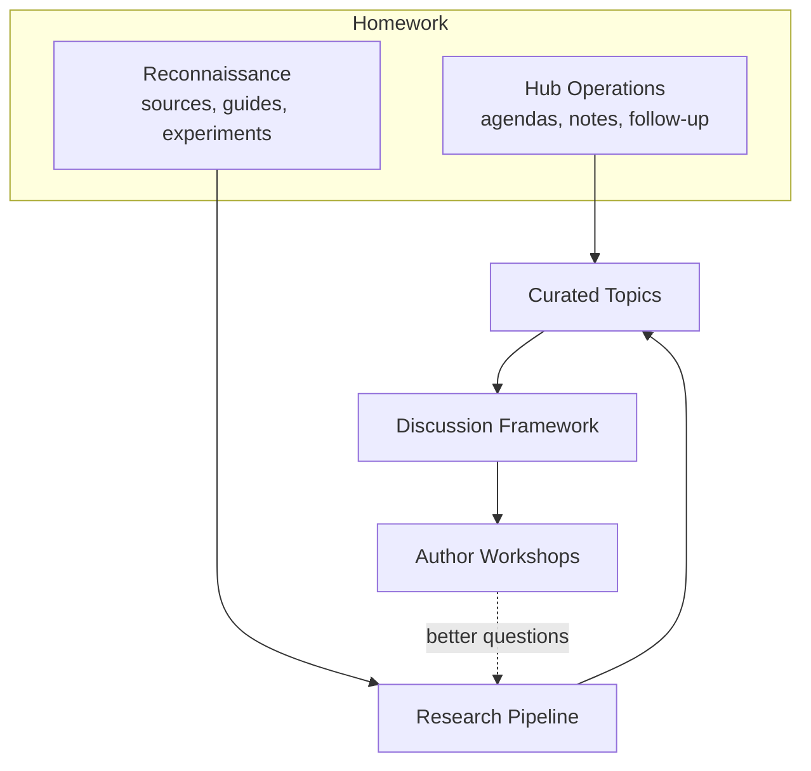

# The Work

The work is organized as **named parts**, not numbered phases. The plan is
expected to change, and parts may overlap, run in parallel, split, or be
reordered. Parts are added, renamed, or retired as the plan changes.

<!-- anchor: named-parts -->

## Named parts of the work

| Part | Group | What it is | Status |
|---|---|---|---|
| **Reconnaissance** | Homework | The Prometheus team explores FHIR guide sources, runs small experiments, and learns which questions can usefully be asked | Under way |
| **Hub Operations** | Homework | Conformance runs agendas, notes, and follow-up in its InteropHub Topic Space | Under way |
| **Research Pipeline** | Homework | A repeatable way to discover guides, collect evidence, and prepare findings, designed from what Reconnaissance learns | Not started |
| **Curated Topics** | Homework | Selected findings become Conformance topics in InteropHub | Not started |
| **Discussion Framework** | Homework | A framework for reviewing a guide's conformance design with its authors; not a scoring or certification tool | Not started |
| **Author Workshops** | Engagement | Voluntary, collaborative sessions with guide authors | After the homework |
| **Year-End Review** | Checkpoint | A look back at 2027 to plan the group's next steps | End of 2027 |

The homework is expected to take about six months. That is an estimate, not a
fixed date; outreach begins when the homework supports it.

## Reconnaissance

Reconnaissance asks one question:

> **What can we discover, what information is available, and what questions
> can we usefully ask?**

It produces learning, not production infrastructure. Its outputs include:

- a map of guide sources
- a small experimental collection of guides
- examples of useful, ambiguous, and failed results
- a recommendation for what to try next

It deliberately does not try to inventory every guide, build a platform, score
guides, decide what good practice is, publish directly to InteropHub, or
prepare outreach.

**Two connected lines of research:**

- **Guide discovery and monitoring.** What guides and versions exist, what they
  publish, what changed, and what requirements can be located.
- **Conformance knowledge.** What a conformance concept means, how its meaning
  differs between FHIR releases, and what is authoritative, interpreted,
  disputed, or unresolved.

**Sources.** No single source answers every question. The sources include:

- the published FHIR specification by release, the FHIR IG Registry, guide
  package histories, and exact-version packages
- published guide pages and continuous builds
- source repositories
- HL7 Jira, Confluence, and ballot records
- validators and test assets
- government, national, and IHE sources
- publication announcements and community chat channels

Community discussion is evidence of questions and practice. It is not
authority on its own.

**A small start.** The proposed starting sample is five guides chosen for
variety rather than coverage: US Core, International Patient Summary, Bulk
Data Access, AU Core, and IHE MHD. It is paired with five concepts:

- Must Support and obligations
- slicing
- differential versus snapshot
- CapabilityStatement claims
- validation versus behavioral conformance

**Five starting questions to ask of a guide:**

1. Which actors are defined, and are they backed by CapabilityStatements?
2. Which constraints are local, and which are inherited?
3. What validation and testing expectations are stated, and what executable
   artifacts exist?
4. How are errors, acknowledgments, and processing outcomes specified?
5. Where is local variation permitted, and is that permission stated in
   narrative or in computable form?

These are starting questions, not a scorecard. Rob and Frank refine them as
examples come in. A key review question is whether an agent found meaningful
evidence or only matched familiar words.

**An early demonstration** should be inspectable. It should show what was
found, why, and what could not be established, including at least one
failure, ambiguity, or correction. Success means traceable evidence and better
questions, not a large number of documents collected.

## Hub Operations

Conformance uses its InteropHub Topic Space to:

- represent current work as topics
- build meeting agendas from those topics
- keep notes, decisions, and follow-up with each topic

This runs alongside everything else and does not wait for the research.
Later, InteropHub may also support invitations, pre-meeting questionnaires,
scheduling, and workshop notes.

InteropHub holds **curated topics only**. The detailed research, including
packages, extracted content, and AI observations, stays in the Prometheus
research environment.

## Research Pipeline and Curated Topics

**Research Pipeline.** If Reconnaissance shows the value, the Research
Pipeline would become a repeatable capability that:

- discovers new and changed guides
- keeps source and version information
- investigates specific questions
- preserves evidence
- separates machine-generated observations from expert conclusions

The pipeline can be summarized as:

> broad discovery → AI-assisted research → expert review → curated topic →
> Conformance discussion

Its design comes from Reconnaissance experience rather than being fixed in
advance.

**Curated Topics.** A curated topic gives the group what it needs to
understand why something matters and decide what to do next:

- the guide or project, with its version and sponsor
- links
- the reason for Conformance interest
- questions worth investigating
- a summary of selected evidence
- follow-up status

## Discussion Framework

Once enough guides have been reviewed, Conformance would draft a
**Conformance Design Review and Discussion Framework** to use with guide
authors. It helps authors and experts think systematically about how a guide
expresses and supports conformance. It does not decide whether a guide passes
or fails.

Candidate areas, to be confirmed by what the research shows:

- actors and their responsibilities
- required and optional behavior, and how obligations are expressed
- testability, validation, and testing
- errors and acknowledgments
- exceptions and local variation
- capability declarations
- examples and test data
- versioning and compatibility
- supporting tools and implementation experience

An earlier proposal included a set of reusable questions that can feed the
framework:

- **Implementation obligations.** Who must implement, are both sender and
  receiver obligations defined, and what must an implementer do to claim
  conformance?
- **Requirements and variation.** Which requirements are meant to be
  testable, where variation is allowed, and whether an implementation can
  materially change a requirement and still claim conformance.
- **Validation and testing.** What testing is expected, what reference
  implementations, examples, or validators will exist, and who maintains them.
- **Exchange outcomes.** How receipt, acceptance, rejection, and business
  processing are distinguished, how errors are reported, whether partial
  success is possible, and what retry or correction is expected.

## Author Workshops

When the research and framework are useful enough, Conformance would invite
selected guide authors to voluntary workshops. The proposed sequence:

1. The authors receive an invitation that explains the collaborative purpose.
2. They complete a short questionnaire and choose a time.
3. Conformance and the Prometheus team prepare evidence-based questions.
4. The authors present their guide, intentions, and concerns.
5. The group discusses the guide using the framework.
6. The authors may correct the notes.
7. Conformance records follow-up and improves its questions.

A workshop is a structured conversation and a chance for expert reflection.
It is **not** certification, approval, a score, a publication gate, a
compliance audit, an automated AI judgment, or a requirement to accept
recommendations. Authors are treated as experts in their own use cases.

Each workshop should improve the authors' understanding of their own
conformance approach, Conformance's understanding of current practice, the
framework, and the research questions.

## Parked and future work

- **PSS Engagement** (parked). The first proposal turned each Project Scope
  Statement review into an invitation to brief the group. The research-first
  approach replaced it, although its question set is reused above.
- **Project Intake** (future). A broader AI-assisted intake for InteropHub.
  See [Related Work](#related-work).

## People and roles

| Participant | Role |
|---|---|
| **Nathan Bunker** (Conformance cochair) | Coordinates the reboot; leads Hub Operations; prepared the Reconnaissance starter packet |
| **Rob Snelick and Frank Oemig** | Joint expert review: interpret findings, refine questions, and shape the Discussion Framework |
| **Prometheus team** (Youssef Bouij, Abdelghani El Ouakili) | Carry out Reconnaissance; run experiments, preserve evidence, report findings and limitations; build the Research Pipeline if justified |
| **Conformance Work Group** | Guides the reboot, discusses findings, tests whether the questions are useful, and will host Author Workshops |
| **Guide authors** | No current assignment. Later, voluntary workshop participants who explain their goals, correct misunderstandings, and consider improvements |
